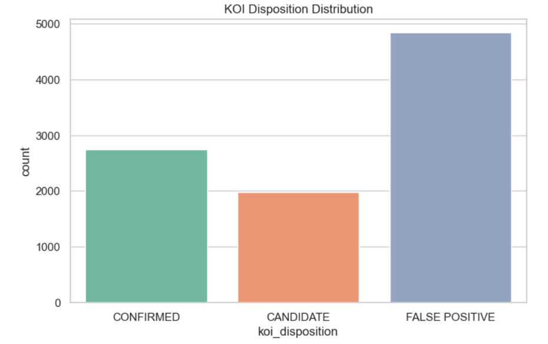
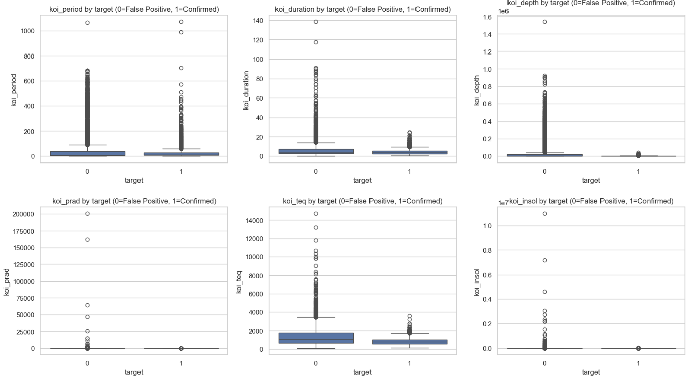
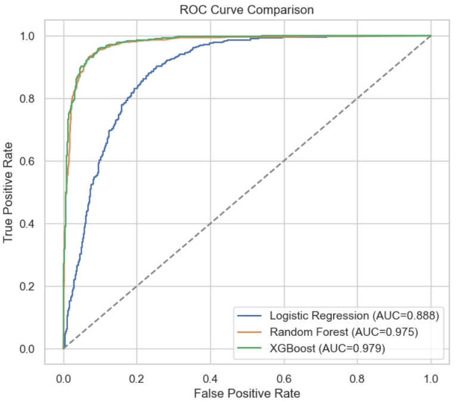
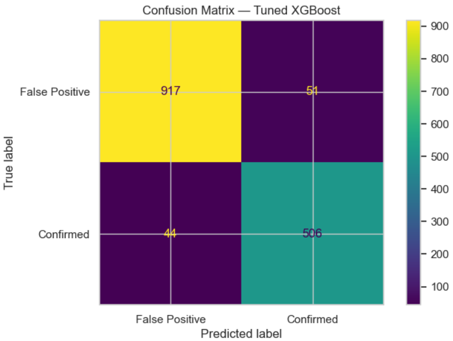
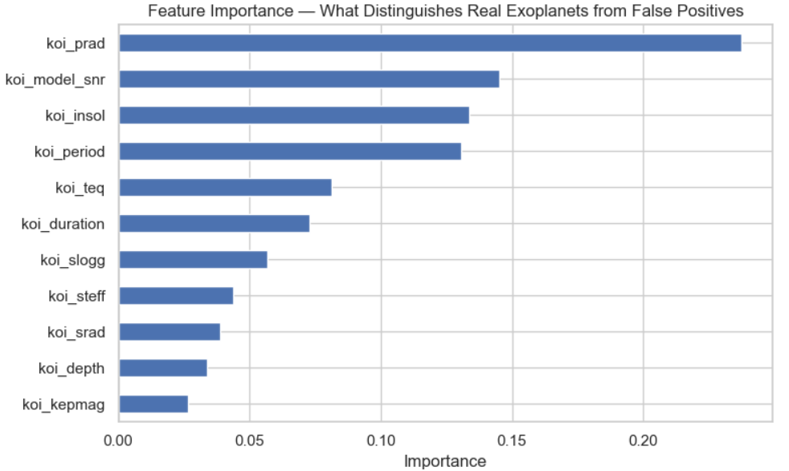
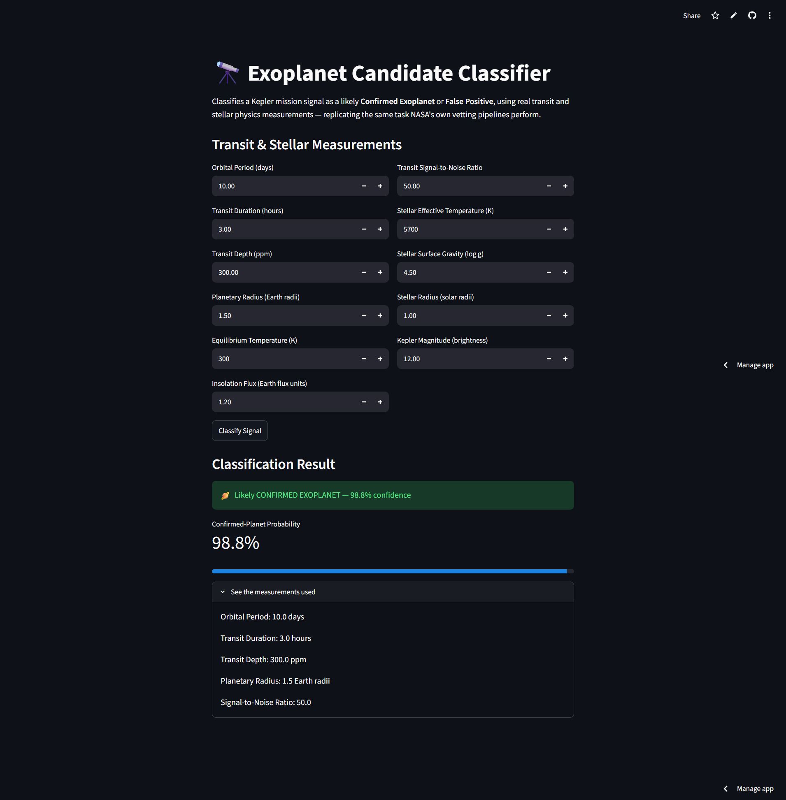
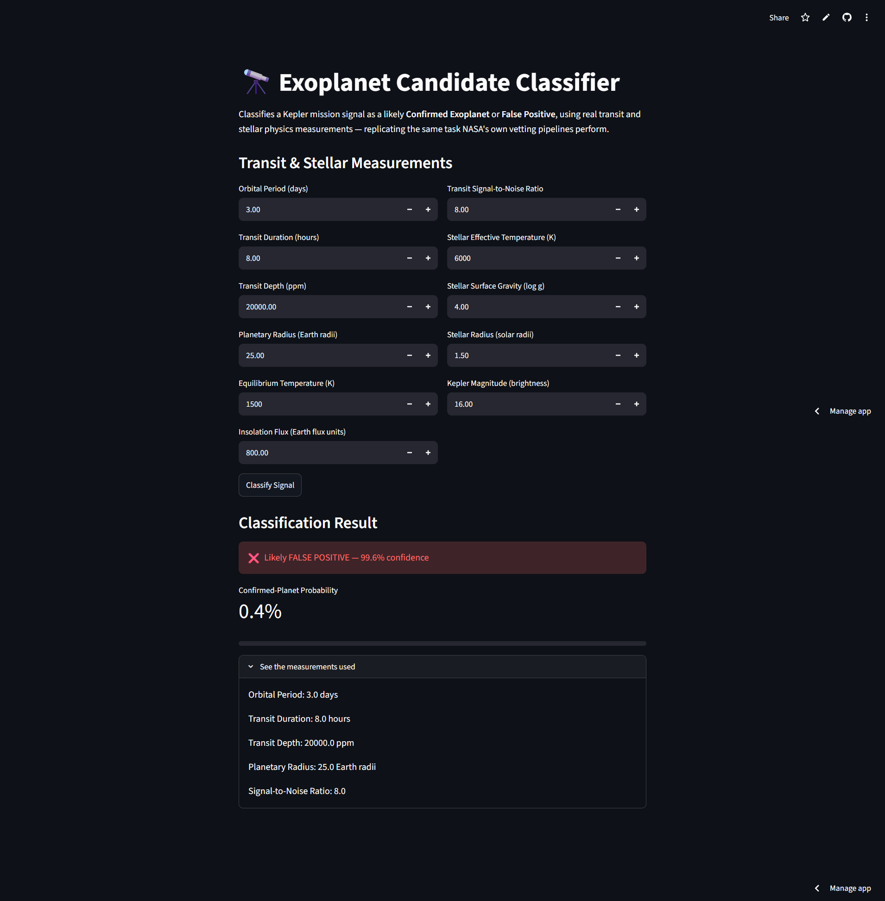

# Exoplanet Classification — NASA Kepler Mission Data

Classifying whether a Kepler-detected signal is a **Confirmed Exoplanet** or a **False Positive**, using real transit and stellar physics measurements — replicating a real task NASA's own vetting pipelines (nicknamed the "Robovetter") perform, historically using the same Random Forest technique used here.

## Problem Statement

**NASA's Kepler mission identified thousands of candidate exoplanet signals, each requiring careful vetting to distinguish genuine planets from false positives caused by eclipsing binary stars, instrumental noise, or other astrophysical artifacts. This project builds a classifier on real transit and stellar physics measurements to automate initial candidate screening — the same task NASA's own "Robovetter" pipeline performs — allowing astronomers to focus limited manual review time on the most genuinely ambiguous cases rather than every single signal.**

## Dataset

- **Source:** [NASA Exoplanet Archive — Kepler Objects of Interest (KOI) Cumulative Table](https://exoplanetarchive.ipac.caltech.edu/) — official NASA mission data, not a Kaggle mirror
- **Content:** Transit and stellar measurements for thousands of Kepler-detected signals, each labeled CONFIRMED, CANDIDATE, or FALSE POSITIVE by NASA's vetting process

## Approach

1. **Data Acquisition** — downloaded the real KOI cumulative table directly from the NASA Exoplanet Archive
2. **Target Definition** — filtered to CONFIRMED vs. FALSE POSITIVE only (excluded ambiguous CANDIDATE rows still under evaluation)
3. **A genuine leakage check** — identified that NASA's own pre-computed false-positive flags (`koi_fpflag_*`) are near-perfectly correlated with the target, since they're intermediate outputs of the same labeling process. **Deliberately excluded these from the feature set**, training only on raw physical measurements — a more honest, harder, more generalizable model
4. **Cleaning** — imputed missing physical measurements with medians
5. **Modeling** — compared Logistic Regression, Random Forest, and XGBoost on genuine transit/stellar physics features; tuned the best model with GridSearchCV
6. **Evaluation** — accuracy, F1-score, ROC-AUC, confusion matrix
7. **Explainability** — feature importance showing which physical measurements most distinguish real planets from false positives
8. **Scientific Impact Framing** — estimated astronomer review time saved by pre-screening with the model

## Key Results

| Model | Accuracy | F1-Score | ROC-AUC |
|---|---|---|---|
| Logistic Regression | 0.815 | 0.758 | 0.888 |
| Random Forest | 0.928 | 0.902 | 0.975 |
| XGBoost (tuned) | **0.94** | **0.94** | **0.98** |

**Top distinguishing features (by importance):**
1. **koi_prad** (0.237) — planetary radius; physically implausible radii (e.g. larger than Jupiter) are a classic signature of false positives like eclipsing binaries
2. **koi_model_snr** (0.145) — transit signal-to-noise ratio; noisy, low-confidence signals are more often false positives
3. **koi_insol** (0.134) — insolation flux; extreme values can indicate an implausible orbital configuration

## Scientific Impact

**The tuned XGBoost model achieved an accuracy of 93.7%, allowing it to classify most candidates with high confidence. Based on the chosen confidence thresholds (0.3–0.7), only 2.5% of the 7,586 candidates would still require manual review by astronomers. Assuming each manual review takes 15 minutes, the model could save approximately 1,849 hours of expert review time. This demonstrates that machine learning can significantly accelerate the exoplanet discovery pipeline by automatically filtering obvious cases and allowing astronomers to focus on the small number of uncertain candidates, improving both efficiency and scientific productivity.**

## A Note on Excluded Features

This model deliberately does NOT use NASA's own `koi_fpflag_*` columns, even though including them would trivially boost accuracy. They're derived from the same vetting process that produces the label itself, making them a form of data leakage. Excluding them means the model has to learn from genuine physical measurements, producing a harder but more honest and generalizable result.

## How to Run

```bash
git clone <your-repo-url>
cd exoplanet-classification

conda create -n exoplanet python=3.10 -y
conda activate exoplanet
pip install -r requirements.txt

jupyter notebook exoplanet_project.ipynb
streamlit run app.py
```

## Live Demo

🔗 [Try the app here](https://exoplanet-classification-7bp82btxm5fbmdmiflkxan.streamlit.app/)

## Screenshots

**KOI disposition distribution — Confirmed / False Positive / Candidate:**


**Physical feature distributions by target — confirmed planets vs. false positives:**


**Model comparison — ROC curve across Logistic Regression, Random Forest, and XGBoost:**


**Confusion matrix — tuned XGBoost:**


**Feature importance — what distinguishes real exoplanets from false positives:**


**Live app — high-confidence confirmed exoplanet (98.8%):**


**Live app — high-confidence false positive (0.4%):**


A **98.4-point spread** between the two extreme test profiles , confirming the model correctly separates physically plausible planetary signals from implausible ones (huge radius, low signal-to-noise) without ever seeing NASA's own pre-computed vetting flags.

## Tech Stack

Python · pandas · scikit-learn · XGBoost · NASA Exoplanet Archive · Streamlit
